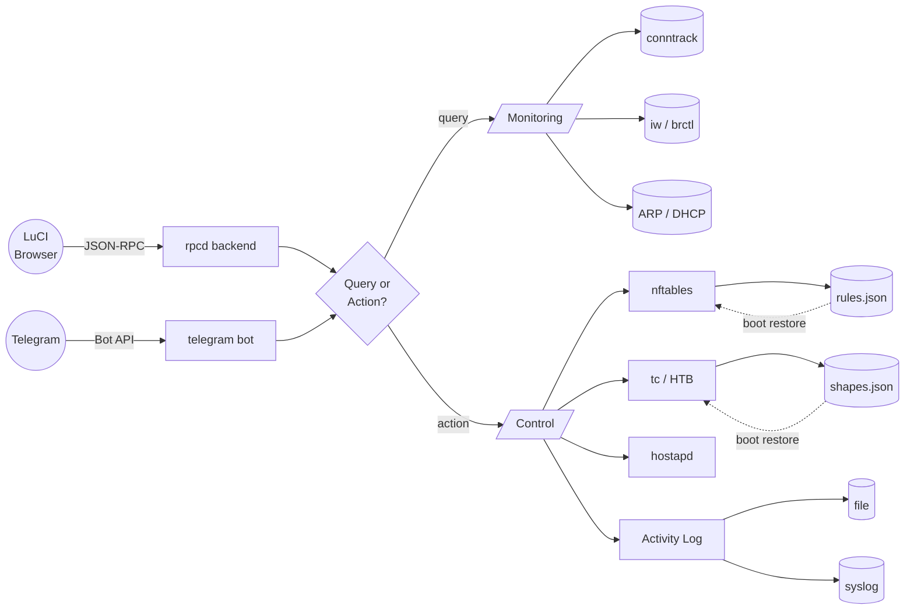

# luci-app-trafficctl

[](https://github.com/YusDyr/luci-app-trafficctl/actions/workflows/ci.yml)
[](https://github.com/YusDyr/luci-app-trafficctl/actions/workflows/auto-release.yml)
[](https://github.com/YusDyr/luci-app-trafficctl/security/code-scanning)
[](https://github.com/YusDyr/luci-app-trafficctl/releases/latest)
[](LICENSE)

Per-device traffic monitoring and control for OpenWrt routers. Monitor connections, limit bandwidth, shape traffic, block internet access, and manage WiFi MAC filtering -- all from a single LuCI page.

---

I built this because I wanted a reliable one-click way to cut my kids off the internet — and found that doing it properly on OpenWrt is surprisingly awkward. Most approaches either miss already-established connections (so the device stays online until the session times out on its own), or require navigating across several LuCI pages just to get something done.

Custom shell scripts solved the immediate problem. But once I had something working, I wanted to actually *see* what was happening on the network — who was online, how much traffic each device was generating, where they were connecting to. So I added a live traffic table.

That opened the door to more: which interface is each device on? What's the TCP state breakdown? What are the top destinations? One thing led to another, and the connection detail view followed.

A hard internet block also felt heavy-handed for everyday use — sometimes slowing a device down is better than cutting it off entirely. So I added rate limiting and traffic shaping via tc/HTB, with persistence across reboots.

After that, the focus shifted to making the whole thing convenient to live with: a recent-devices bar for one-click access, live sparkline graphs with a hover popup, a searchable device picker, configurable columns, activity logging.

The latest addition is Telegram — instant notifications when a new device joins the network, and the ability to block, unblock, or throttle any device directly from my phone without opening a browser.

I hope it turns out as useful for you as it has been for me.

---

| | |
|---|---|
| **Monitoring** | Live bandwidth sparklines · TCP state breakdown · Per-connection detail · rDNS lookup |
| **Control** | Internet block · WiFi MAC deny · Rate limiter (nft policer) · Traffic shaper (tc/HTB) |
| **Visibility** | WiFi band (2.4G/5G/6G) · LAN port detection · Reachability indicator · Extended stats |
| **UX** | Searchable device picker · Column toggles · Colorblind-safe · Dark + light theme |
| **Automation** | Telegram bot · Activity logging · Boot persistence · DHCP hotplug new-device alerts |

---

## Table of Contents

- [Screenshots](#screenshots)
- [Features](#features)
- [System Requirements](#system-requirements)
- [Compatibility](#compatibility)
- [IPv6 coverage](#ipv6-coverage)
- [Installation](#installation)
- [Quick Start](#quick-start)
- [Configuration](#configuration)
- [Architecture](#architecture)
- [Project Layout](#project-layout)
- [Documentation](#documentation)
- [Contributing](#contributing)
- [License](#license)

---

## Screenshots

<table>
<tr>
<td align="center"><b>Dashboard — live speed graph</b></td>
<td align="center"><b>Block / Unblock Internet</b></td>
</tr>
<tr>
<td></td>
<td></td>
</tr>
<tr>
<td align="center"><b>Rate Limiting &amp; Traffic Shaping</b></td>
<td align="center"><b>Interactive speed graph popup</b></td>
</tr>
<tr>
<td></td>
<td></td>
</tr>
</table>

<details>
<summary>More screenshots — light theme, settings, Telegram, activity log…</summary>
<br/>

<table>
<tr>
<td align="center"><b>Overview — light theme</b></td>
<td align="center"><b>Per-device connections</b></td>
</tr>
<tr>
<td></td>
<td></td>
</tr>
<tr>
<td align="center"><b>WiFi blocked</b></td>
<td align="center"><b>Link / band column</b></td>
</tr>
<tr>
<td></td>
<td></td>
</tr>
<tr>
<td align="center"><b>Extended statistics (all devices)</b></td>
<td align="center"><b>Extended statistics (per device)</b></td>
</tr>
<tr>
<td></td>
<td></td>
</tr>
<tr>
<td align="center"><b>Group connections by service</b></td>
<td align="center"><b>Group connections by hostname</b></td>
</tr>
<tr>
<td></td>
<td></td>
</tr>
<tr>
<td align="center"><b>Searchable device picker</b></td>
<td align="center"><b>Unreachable device indicator</b></td>
</tr>
<tr>
<td></td>
<td></td>
</tr>
<tr>
<td align="center"><b>Settings walkthrough</b></td>
<td align="center"><b>Column toggles</b></td>
</tr>
<tr>
<td></td>
<td></td>
</tr>
<tr>
<td align="center"><b>Telegram Bot — configure &amp; toggle</b></td>
<td align="center"><b>Telegram Bot settings</b></td>
</tr>
<tr>
<td></td>
<td></td>
</tr>
<tr>
<td align="center"><b>Logging &amp; Persistence settings</b></td>
<td align="center"><b>Activity Log panel</b></td>
</tr>
<tr>
<td></td>
<td></td>
</tr>
</table>

</details>

---

## Features

- **Real-time Per-device Monitoring** -- View active connections per device with TCP/UDP counts, TCP state breakdown, destination IPs, and live bandwidth speed (sparkline graphs with rate limit overlay).
- **Global Overview** -- Optional whole-router panel (the **Overview** toggle in Settings > Display): uplink throughput graph, per-interface breakdown with WAN/LAN/VPN roles and sparklines, and a live top-talkers list. Reads per-interface kernel counters and the speed map the device table already computes, and polls on the existing Poll interval rather than a timer of its own.
- **Interactive Speed Graphs** -- Hover any sparkline for a full-size popup graph with: download + upload dual lines, gradient area fill, min/max band, crosshair with precise values, rate limit line, nice-value Y axis (multiples of 100/500 Kbit/s). Full history from page load.
- **Traffic Shaping (Queue)** -- tc/HTB classes on the LAN bridge with fq_codel leaf qdiscs. Queues excess traffic instead of dropping, providing smoother throughput.
- **Separate Upload and Download Ceilings** -- Both the shaper and the limiter take an upload ceiling of its own: click **⇅ Split up/down** in the Speed Limit panel, type the upload speed and pick the download one (or press Enter). The device's status line and the Limit column then show both, e.g. `↓ 10 Mbit/s / ↑ 2 Mbit/s`. Without a split, upload gets the same ceiling as download.
- **Rate Limiting (Policer)** -- nftables packet dropping when a device exceeds the configured rate. Instant enforcement, no queuing. Unlike the shaper it owns no qdisc, so it works on a router already running SQM/cake — where the shaper deliberately declines rather than tear down somebody else's QoS, and says so.
- **Subnet / VLAN Limits** -- A limit can target a whole subnet (`192.168.20.0/24`) or the entire network, not only one device. Two readings of "20 Mbit for the IoT VLAN" are both available and are chosen explicitly: **each** gives every device its own 20 Mbit bucket, **shared** gives the whole VLAN one 20 Mbit bucket *between them* — the aggregate cap. Pick a monitored subnet from the target chips in the Speed Limit panel (select "All active devices" first); active subnet limits are listed there with their drop counters and a Remove button. Subnets the router does not monitor are flagged rather than silently accepted: a firewall zone other than `lan` with `masq=1` — the usual way to isolate a guest VLAN — is excluded from monitoring, and a limit on it would never match a packet. From the CLI: `trafficctl-ratelimit.sh 192.168.20.0/24 20000 "iot-cap" shared`.
- **Internet Blocking** -- Layer 3 drop rules per device. Connections are killed immediately and counter stats are tracked.
- **Global Internet Cut** -- One control that takes every device off the internet while the LAN keeps working, for plugging in a new device and configuring it locally before it is allowed out. Timed by default (15 min / 1 h / 4 h, or until you switch it back), so it reverts by itself. Devices keep reaching each other and the router, so LuCI stays available from the LAN; remote access that lands on a LAN host first (Tailscale on a NAS, a tunnel from a LAN box) stops while it is on. Traffic is stopped on the way in, at prerouting, so a transparent proxy running on the router (podkop/sing-box, passwall) cannot carry it out either — and the router's own traffic, including that proxy's outbound path, is untouched. It does **not** survive a reboot unless you tick "Keep after reboot".
- **WiFi MAC Filtering** -- Block any device from associating with WiFi via hostapd_cli deny ACL. Only the target client is deauthenticated -- no wifi reload, other clients stay connected. Works across all radio interfaces (2.4 GHz, 5 GHz, 6 GHz) automatically.
- **Interface Detection** -- Shows actual connection interface: WiFi band (2.4G/5G/6G), LAN port name (lan2/lan3/lan4), or `routed` for clients behind a downstream router.
- **Downstream Routers** -- Devices on subnets behind a second router are monitored too: subnets with a route via a LAN next-hop are detected automatically, any flow this router NATs is attributed to its original source, and additional CIDRs can be listed in `trafficctl.main.extra_subnets`.
- **Rules tab** -- Every block, speed limit (subnets included), shape and WiFi block in one list, including those on devices that are offline and so missing from the device table. Shows the target, the hostname, whether each rule is in effect now and whether it survives a reboot, with Edit, Remove and Apply.
- **Port Forwards tab** -- Inbound traffic control for DNAT port forwards and router-local open ports: live connection/client/byte stats per forward, instant pause/resume (drop rule, no firewall reload) and inbound rate limiting.
- **Live Speed Polling** -- Optional polling with configurable interval (Off/1/2/5/10/30s) and averaging window (5s-5min); shows sparkline per device with spike filtering. Both can be stored as router-wide defaults via UCI (`poll_interval`, `avg_window`) for browsers that have not chosen their own.
- **Reverse DNS** -- Optional hostname resolution for external destination IPs with in-memory cache (no repeated lookups). At most 16 new lookups per device poll, so it also works behind resolvers that rate-limit the router, such as AdGuard Home on port 53 with dnsmasq moved to another port.
- **Searchable Device Picker** -- Command palette (search by name, IP, or MAC) with recent devices quick-access bar stored in localStorage.
- **Telegram Bot** -- Optional bot for remote control: device list, block/unblock, rate limit, shape traffic. Runs on the router via long polling, no external server needed. Package `trafficctl-telegram`.
- **Notifications** -- New device, known device back online, limit applied, block applied and internet cut, sent to Telegram, ntfy, a webhook or email (msmtp), each sender with its own events (Status > Traffic Control > Notifications). Every event is also a ubus event (`ubus listen trafficctl.notify`) and runs the scripts in `/etc/hotplug.d/trafficctl/`, for your own automation. See [docs/API.md](docs/API.md#notifications).
- **New Device Detection** -- Discovers new devices via three sources: ARP table, DHCP leases, Wi-Fi station list. Instant DHCP hotplug trigger for near-realtime alerts.
- **Activity Logging** -- Configurable logging of all actions (blocks, ratelimits, shapes, config changes) to a local file and/or syslog. Includes source IP, username, and trigger (LuCI/Telegram/CLI).
- **Default Limit for New Devices** -- Optionally rate-limit or shape a device the first time it appears on the network (Settings > New Device Defaults). Off by default. Switching it on records the devices already present, so only genuinely new ones are affected, and a device that already carries a limit is never overridden.
- **Reboot Persistence** -- Shaping, block, and rate-limit rules optionally survive reboot via hotplug restore. Configurable per UCI option `persist_rules`. A rate limit keeps its bucket layout across the restore, so a subnet limited "5 Mbit each" does not come back as 5 Mbit for the whole subnet.

---

## System Requirements

### Hardware

|               | Minimum              | Recommended          |
|---------------|----------------------|----------------------|
| **RAM**       | 64 MB free           | 128+ MB free         |
| **Flash**     | 300 KB (package)     | 1 MB (with all deps) |
| **CPU**       | Any (MIPS/ARM/x86)   | ARM Cortex-A53+      |

### Software

| Package | Required for | Notes |
|---------|-------------|-------|
| `conntrack` | Core monitoring | Always required |
| `kmod-nft-netdev` | Rate limiter (fw4) | Installed as a dependency; firewall4 does not pull it in |
| `luci-base` | Web interface | Always required |
| `rpcd` | Backend RPC | Always required |
| `tc-full` + `kmod-sched-core` + `kmod-sched-htb` | Traffic shaping | For HTB/fq_codel queues |
| `kmod-ifb` | Upload shaping | Without it the shaper applies to download only, and reports that |
| `iw-full` | Interface detection | WiFi band identification |
| `bridge-utils` | Interface detection | LAN port identification (brctl) |
| `hostapd-utils` | WiFi MAC filtering | Optional for the `trafficctl` backend, so it installs on wired-only builds; `luci-app-trafficctl` still pulls it in. Without it a WiFi block is a temporary (one hour) hostapd ban |
| `curl` + `jsonfilter` | Telegram bot, notifications | jsonfilter is part of base OpenWrt |
| `msmtp` | Email notifications | Optional; configure `/etc/msmtprc` |
| `rpcd-mod-rrdns` | Reverse DNS | Included with `rpcd`; enables rDNS in LuCI, Telegram, and CLI |

## Compatibility

[](https://github.com/YusDyr/luci-app-trafficctl/actions/workflows/compat.yml)

Runs on all architectures (no compiled code, pure shell + LuCI JavaScript).

| OpenWrt Version | Firewall | Status |
|-----------------|----------|--------|
| 25.12 (latest)  | fw4 / nftables | Fully supported |
| 24.10           | fw4 / nftables | Fully supported |
| 23.05           | fw4 / nftables | Fully supported |
| 22.03           | fw4 / nftables | Fully supported |
| 21.02           | fw3 / iptables | Not supported; use 1.30.x |

Version 2.0+ requires OpenWrt 22.03 or newer with firewall4/nftables. OpenWrt 21.02 users should stay on the 1.30.x release series.

**CI-tested on 48 combinations** — every push is verified against real OpenWrt rootfs containers:

| | x86‑64 | x86‑generic | mips\_24kc | aarch64 | arm\_a9 | arm\_a15 | armsr | armvirt32 | i386 |
|---|:---:|:---:|:---:|:---:|:---:|:---:|:---:|:---:|:---:|
| **22.03.7** | ✓ | | | ✓ | | ✓ | | ✓ | |
| **23.05.6** | ✓ | ✓ | ✓ | ✓ | ✓ | ✓ | ✓ | | ✓ |
| **24.10.1** | ✓ | ✓ | ✓ | ✓ | ✓ | ✓ | ✓ | | ✓ |
| **24.10.6** | ✓ | ✓ | ✓ | ✓ | ✓ | ✓ | ✓ | | ✓ |
| **25.12.0** | ✓ | ✓ | ✓ | ✓ | ✓ | ✓ | ✓ | | ✓ |
| **25.12.4** | ✓ | ✓ | ✓ | ✓ | ✓ | ✓ | ✓ | | ✓ |
| **snapshot** | ✓ | | ✓ | ✓ | | | ✓ | | |

Each test builds both `.ipk` files (`trafficctl` and `luci-app-trafficctl`), runs `opkg install --force-depends` inside the real OpenWrt rootfs container for that version/arch, then verifies all files are present and all scripts pass `ash -n` syntax check.

---

## IPv6 coverage

Everything here is keyed on a device's IPv4 address, so **IPv6 coverage is
partial and this table is the whole of it.** Read it before relying on any of
these controls on a dual-stack network.

| Control | IPv4 | IPv6 | Keyed on |
|---|:---:|:---:|---|
| Global internet cut (all devices) | ✅ | ✅ | interface (`oifname`/`fib`) — family-independent |
| WiFi block (MAC deny) | ✅ | ✅ | MAC — the client cannot associate at all |
| Block internet (per device) | ✅ | ✅ | address for v4, **MAC** for v6 |
| Rate limit — **upload** | ✅ | ✅ | address for v4, **MAC** for v6 |
| Rate limit — **download** | ✅ | ✅ | address for v4; for v6 a set of the device's addresses, fed from its own **MAC**-matched frames |
| Traffic shaping (tc/HTB), both directions | ✅ | ❌ | address only |
| Port-forward pause / limit | ✅ | ❌ | address only |
| Byte counters, speed graphs, totals, Prometheus | ✅ | ❌ | address only |

**Why not simply match `ip6 saddr` as well?** Because a client's IPv6 addresses
are not stable. With SLAAC and privacy extensions a device holds several at
once and rotates them on a timer, so a rule written against the address seen
today stops matching tomorrow — silently, which is worse than not having the
rule. The MAC does not rotate, so the rules that *can* be keyed on it are.

**Where a MAC cannot be used, and what happens then:**

- **Download** is not matched on the MAC directly: by the time a reply is on
  its way to the client, the L2 header is not built yet. It is matched on a
  per-device set of the client's IPv6 addresses instead, and that set is filled
  by the client's own traffic: every IPv6 packet it sends arrives with its MAC,
  and its source address goes into the set with a one-hour timeout that each
  packet renews. A new privacy address is covered from its first packet, so the
  set never needs refreshing from the neighbour table and cannot go stale.
- **A device with no DHCP lease and no neighbour entry** — a client behind a
  downstream router, reached through `extra_subnets` or a static route — has no
  MAC this router can see. Its IPv4 rules are applied as before and the reply
  says **"IPv4 only"** in the message, in the LuCI status line and in the
  Telegram bot's answer, rather than reporting an unqualified success.
- **A downstream router itself** is excluded on purpose. Its MAC is the source
  address of every packet it forwards, so a MAC-keyed rule aimed at it would
  black-hole or throttle every client behind it. It too is reported as
  "IPv4 only", naming the reason.

If a device must be cut off completely and its IPv6 cannot be covered, the
**WiFi block** (for wireless clients) and the **global internet cut** (for all
devices) are family-independent and work regardless.

---

## Installation

> **Which file do I need?**
> - **Recommended**: v1.6.5+ (earlier releases are broken — missing status.css, invalid APK format)
> - OpenWrt **22.03 — 24.10** → download `.ipk` (opkg)
> - OpenWrt **25.12+** and snapshot → download `.apk` (apk)
> - Want upgrades through `opkg upgrade` / `apk upgrade`? Add the [package feed](#package-feed-recommended) instead

The app is three packages, released together with the same version:

- **`trafficctl`**: the backend. The `trafficctl` CLI and helper scripts,
  `/etc/config/trafficctl`, the notification and history services, the hotplug
  hooks and the Prometheus CGI.
- **`trafficctl-telegram`**: the Telegram bot (`/etc/init.d/trafficctl-telegram`).
  It depends on `trafficctl`. Up to 1.30.x the bot was part of `trafficctl`.
- **`luci-app-trafficctl`**: the web interface (LuCI views and the rpcd plugin).
  It depends on `trafficctl` and `trafficctl-telegram`.

A router without LuCI needs only `trafficctl`, and `trafficctl-telegram` for
the bot. Upgrading such a router from 1.30.x with only `trafficctl` stops the
bot (the postinst says so in the system log): add `trafficctl-telegram` to the
same command to keep it. To go back to 1.30.x, remove `trafficctl-telegram`
first (`opkg remove trafficctl-telegram` / `apk del trafficctl-telegram`):
1.30.x's single package holds the bot's files itself.

Releases up to 1.28.x shipped both as `luci-app-trafficctl` alone. Upgrading
from one of them moves the backend files into `trafficctl` and keeps your
configuration. From the feed, `opkg upgrade luci-app-trafficctl` /
`apk upgrade luci-app-trafficctl` does it. From downloaded files, install all
of them in one command, as below.

Each release includes multiple filenames for each package:

| Asset name | Purpose |
|-----------|---------|
| `trafficctl.ipk`, `trafficctl-telegram.ipk`, `luci-app-trafficctl.ipk` | Stable download URLs (opkg) |
| `trafficctl_all.ipk`, `trafficctl-telegram_all.ipk`, `luci-app-trafficctl_all.ipk` | Same files, OpenWrt naming convention |
| `trafficctl_X.Y.Z-1_all.ipk`, `trafficctl-telegram_X.Y.Z-1_all.ipk`, `luci-app-trafficctl_X.Y.Z-1_all.ipk` | Same files, version-pinned |
| `trafficctl.apk`, `trafficctl-telegram.apk`, `luci-app-trafficctl.apk` | Stable download URLs (apk) |
| `trafficctl_noarch.apk`, `trafficctl-telegram_noarch.apk`, `luci-app-trafficctl_noarch.apk` | Same files, OpenWrt naming convention |
| `trafficctl_X.Y.Z-r1_noarch.apk`, `trafficctl-telegram_X.Y.Z-r1_noarch.apk`, `luci-app-trafficctl_X.Y.Z-r1_noarch.apk` | Same files, version-pinned |

The "stable URL" links below always download from the latest release — the filename stays constant across versions.

### Package feed (recommended)

Every release is also published as a signed package feed on GitHub Pages
([yusdyr.github.io/luci-app-trafficctl](https://yusdyr.github.io/luci-app-trafficctl/)).
Add the feed and its key once; after that the router's package manager installs
and upgrades the app like any other package, and checks the feed's signature on
every update. Needs HTTPS in `wget` (`libustream-*`, present in default images
since 21.02).

**OpenWrt 22.03 — 24.10 (opkg):**

```sh
wget -O /tmp/trafficctl.pub https://yusdyr.github.io/luci-app-trafficctl/keys/usign-64513c3027229c14.pub
opkg-key add /tmp/trafficctl.pub
echo 'src/gz trafficctl https://yusdyr.github.io/luci-app-trafficctl/opkg' >> /etc/opkg/customfeeds.conf
opkg update
opkg install luci-app-trafficctl
/etc/init.d/rpcd restart
```

**OpenWrt 25.12+ (apk):**

```sh
wget -O /etc/apk/keys/trafficctl.pem https://yusdyr.github.io/luci-app-trafficctl/keys/trafficctl.pem
echo 'https://yusdyr.github.io/luci-app-trafficctl/apk/packages.adb' >> /etc/apk/repositories.d/customfeeds.list
apk update
apk add luci-app-trafficctl
/etc/init.d/rpcd restart
```

`luci-app-trafficctl` pulls in `trafficctl` and `trafficctl-telegram`. Translations install the same way
(`luci-i18n-trafficctl-zh-cn`). To upgrade later:
`opkg update && opkg upgrade trafficctl luci-app-trafficctl`, or
`apk update && apk upgrade trafficctl luci-app-trafficctl`.

> **OpenWrt 25.12, installed from a downloaded `.apk` file?** apk keeps a
> package installed from a file pinned to that file, so `apk upgrade` never
> moves it to the feed's version. Switch it over once:
>
> ```sh
> apk add 'luci-app-trafficctl>=1.29.0'
> ```
>
> After that `apk upgrade` works as above.

No `--allow-untrusted` is
needed: the apk index is signed with [`keys/apk-signing.pub`](keys/apk-signing.pub)
(published as `trafficctl.pem`), the opkg index with
[`keys/usign-64513c3027229c14.pub`](keys/usign-64513c3027229c14.pub). The feed
holds the latest release only. [`tools/build-feed.sh`](tools/build-feed.sh)
builds it.

The single-file methods below still work and need no feed.

### OpenWrt 25.12+ (.apk)

**Option A — LuCI web UI:**
1. Download [`trafficctl.apk`](https://github.com/YusDyr/luci-app-trafficctl/releases/latest/download/trafficctl.apk), [`trafficctl-telegram.apk`](https://github.com/YusDyr/luci-app-trafficctl/releases/latest/download/trafficctl-telegram.apk) and [`luci-app-trafficctl.apk`](https://github.com/YusDyr/luci-app-trafficctl/releases/latest/download/luci-app-trafficctl.apk) to your computer
2. In LuCI: **System → Software → Upload Package...**
3. Upload `trafficctl.apk` first, then `trafficctl-telegram.apk`, then `luci-app-trafficctl.apk`

**Option B — SSH (recommended):** the three files in one command, `trafficctl` first:

```sh
cd /tmp && wget -O trafficctl.apk https://github.com/YusDyr/luci-app-trafficctl/releases/latest/download/trafficctl.apk && wget -O trafficctl-telegram.apk https://github.com/YusDyr/luci-app-trafficctl/releases/latest/download/trafficctl-telegram.apk && wget -O luci-app-trafficctl.apk https://github.com/YusDyr/luci-app-trafficctl/releases/latest/download/luci-app-trafficctl.apk && apk add --allow-untrusted trafficctl.apk trafficctl-telegram.apk luci-app-trafficctl.apk
# If you get "modified conffile" on upgrade, add `--force-maintainer` to override
```

> **Why `--allow-untrusted`?** OpenWrt does not sign individual `.apk` files —
> package signatures apply to a repository *index*, not to a standalone file
> downloaded from a GitHub release. Upstream removed per-package apk signing
> outright in October 2025. `--allow-untrusted` is therefore the normal way to
> install a single package file, not a security workaround being suggested
> lightly. If you want to pin what you install, download the version-stamped
> assets (`trafficctl_X.Y.Z-r1_noarch.apk`, `luci-app-trafficctl_X.Y.Z-r1_noarch.apk`) rather than the floating
> `latest` URLs, so the files cannot change under you between download and
> install.

### OpenWrt 22.03 — 24.10 (.ipk)

**Option A — LuCI web UI:**
1. Download [`trafficctl.ipk`](https://github.com/YusDyr/luci-app-trafficctl/releases/latest/download/trafficctl.ipk), [`trafficctl-telegram.ipk`](https://github.com/YusDyr/luci-app-trafficctl/releases/latest/download/trafficctl-telegram.ipk) and [`luci-app-trafficctl.ipk`](https://github.com/YusDyr/luci-app-trafficctl/releases/latest/download/luci-app-trafficctl.ipk) to your computer
2. In LuCI: **System → Software → Upload Package...**
3. Upload `trafficctl.ipk` first, then `trafficctl-telegram.ipk`, then `luci-app-trafficctl.ipk`

**Option B — SSH** (requires HTTPS support — `libustream-wolfssl` or `libustream-openssl`). The three files in one command, `trafficctl` first:

```sh
opkg install https://github.com/YusDyr/luci-app-trafficctl/releases/latest/download/trafficctl.ipk https://github.com/YusDyr/luci-app-trafficctl/releases/latest/download/trafficctl-telegram.ipk https://github.com/YusDyr/luci-app-trafficctl/releases/latest/download/luci-app-trafficctl.ipk
```

**Option C — SSH from your machine:**

```sh
ssh root@router 'opkg install https://github.com/YusDyr/luci-app-trafficctl/releases/latest/download/trafficctl.ipk https://github.com/YusDyr/luci-app-trafficctl/releases/latest/download/trafficctl-telegram.ipk https://github.com/YusDyr/luci-app-trafficctl/releases/latest/download/luci-app-trafficctl.ipk'
```

### Uninstalling

```sh
# OpenWrt 25.12+ (apk)
apk del luci-app-trafficctl trafficctl-telegram trafficctl

# OpenWrt 22.03 - 24.10 (opkg): the web interface first, then the bot, then
# the backend
opkg remove luci-app-trafficctl
opkg remove trafficctl-telegram
opkg remove trafficctl

# either way, reload the LuCI backend afterwards
/etc/init.d/rpcd restart
```

Removing the packages deletes the scripts and the LuCI page but leaves
`/etc/config/trafficctl` in place, so your settings survive a reinstall. Delete
it yourself if you want a clean slate:

```sh
rm -f /etc/config/trafficctl
```

Any blocks, rate limits or shapers that were active are **not** persistent
firewall/tc state — they disappear on the next reboot. To clear them
immediately before removing the package, unblock/unlimit the affected devices
from the dashboard first, or reboot the router after uninstalling.

Removing `trafficctl-telegram` stops and disables the bot, and removing
`trafficctl` the notification watcher (`trafficctl-notify`).

### From source (OpenWrt build system)

```sh
# Add to your feeds.conf (the package depends on luci, so make sure
# luci is also configured — it is by default in feeds.conf.default):
echo "src-git trafficctl https://github.com/YusDyr/luci-app-trafficctl.git" >> feeds.conf

# Update both feeds (luci must be updated before trafficctl is scanned):
./scripts/feeds update luci trafficctl
./scripts/feeds install -p trafficctl luci-app-trafficctl

# Enable and build. `feeds install` links trafficctl (the backend) as well,
# because luci-app-trafficctl depends on it:
echo 'CONFIG_PACKAGE_luci-app-trafficctl=m' >> .config
make defconfig
make package/trafficctl/compile package/luci-app-trafficctl/compile V=s
```

### Manual installation

Copy the backend tree (`trafficctl/files/`) and the web interface
(`luci-app-trafficctl/root/`, `luci-app-trafficctl/htdocs/`) to the router's
filesystem, then restart rpcd:

```sh
scp -r trafficctl/files/* root@router:/
scp -r luci-app-trafficctl/root/* root@router:/
scp -r luci-app-trafficctl/htdocs/luci-static root@router:/www/
ssh root@router 'chmod +x /usr/libexec/trafficctl/trafficctl-*.sh /usr/libexec/rpcd/luci.trafficctl && /etc/init.d/rpcd restart'
```

### Required packages

<details>
<summary>OpenWrt 25.12+ (apk)</summary>

```sh
# Core (always required)
apk add conntrack luci-base rpcd

# For traffic shaping
apk add tc-full kmod-sched-core kmod-sched-htb

# For upload shaping — without it the shaper applies download only and says so
# (upload is redirected into an IFB device via act_mirred, which ships with the
# sched core package above)
apk add kmod-ifb

# For interface detection (WiFi band + LAN port)
apk add iw-full bridge-utils

# For WiFi MAC deny / deauthenticate (optional for the trafficctl backend;
# without it a WiFi block is a temporary one-hour ban)
apk add hostapd-utils

# rpcd-mod-rrdns is included with rpcd (no extra install needed)

# For the Telegram bot (optional; luci-app-trafficctl pulls it in)
apk add trafficctl-telegram
```

</details>

<details>
<summary>OpenWrt 22.03 — 24.10 (opkg)</summary>

```sh
# Core (always required)
opkg install conntrack luci-base rpcd

# For traffic shaping
opkg install tc-full kmod-sched-core kmod-sched-htb

# For upload shaping — without it the shaper applies download only and says so
# (upload is redirected into an IFB device via act_mirred, which ships with the
# sched core package above)
opkg install kmod-ifb

# For interface detection (WiFi band + LAN port)
opkg install iw-full bridge-utils

# For WiFi MAC deny / deauthenticate (optional for the trafficctl backend;
# without it a WiFi block is a temporary one-hour ban)
opkg install hostapd-utils

# rpcd-mod-rrdns is included with rpcd (no extra install needed)

# For the Telegram bot (optional; luci-app-trafficctl pulls it in)
opkg install trafficctl-telegram
```

</details>

---

## Quick Start

1. Install the package (see above).
2. Navigate to **Status > Traffic Control** in LuCI.
3. The summary table shows all active devices with connection counts, traffic, speed limits, and connection interface.
4. Use the search bar to find a device by name, IP, or MAC.
5. Select a device to see its per-connection detail table.
6. Use the action buttons to pause internet, block WiFi, or set a speed limit.

### Telegram Bot (optional)

1. Create a bot via [@BotFather](https://t.me/BotFather) and copy the token.
2. Send any message to your bot and find your chat ID via `https://api.telegram.org/bot<TOKEN>/getUpdates`.
3. In LuCI, expand **Settings > Telegram Bot**, enter token and chat ID, click **Test**, then **Save**.
4. In Telegram, send `/devices` to see the device list with action buttons.
5. Which events reach the chat, and the new device message, are set on the **Notifications** tab (Telegram card). The bot does not have to run for notifications.

The bot obeys the chat, not a person: with a group's chat ID, every member of that group can block, limit and unblock devices (as in 1.30.x). Use your private chat with the bot unless that is what you want.

### Notifications (optional)

On **Status > Traffic Control > Notifications**, switch on a sender (Telegram, ntfy, webhook, email), pick its events, fill in its fields and click **Save**, then **Send test**. The device scan behind "New device" and "Known device online" runs as `/etc/init.d/trafficctl-notify` only while some sender (or a hotplug script) takes those events.

A script in `/etc/hotplug.d/trafficctl/` gets every event, with `ACTION` set to the event name:

```sh
# /etc/hotplug.d/trafficctl/10-log
[ "$ACTION" = new_device ] && logger -t my-hook "new device $MAC $IP $NAME"
```

---

## Configuration

### Speed Limit Modes

| Mode | Mechanism | Behavior | Best For |
|------|-----------|----------|----------|
| **Shaper** | tc/HTB + fq_codel | Queues excess packets | Smooth streaming, lower jitter |
| **Limiter** | nft `limit rate` | Drops excess packets | Quick enforcement, low overhead |

### Persistence

**Note**: As of v1.6.5+, the runtime data directory is `/etc/trafficctl/` (previously `/etc/trafficmon/`).

- Shaping rules are always saved to `/etc/trafficctl/shapes.json` and restored on boot.
- Block and rate-limit rules are optionally persistent when `persist_rules` is enabled in Settings > Logging & Persistence (saved to `/etc/trafficctl/rules.json`).
- On reboot, the hotplug script at `/etc/hotplug.d/iface/99-trafficctl-shapes` restores all saved rules (shapes, blocks, ratelimits) when the LAN interface comes up.

### Activity Logging

- All mutable actions are logged with timestamp, source IP, username, trigger (luci/telegram/cli), and target.
- Log file: `/tmp/trafficctl/activity.log` (volatile; survives until reboot). Path and max lines are configurable via UCI.
- Optionally duplicates to syslog (`logger -t trafficctl`) for remote log collection.
- Per-category toggles: blocks, ratelimits, shapes, telegram, config changes.

### Reverse DNS

- The rDNS toggle in the device view resolves the connection table's public destinations through rpcd's `network.rrdns`, which asks the first `nameserver` in `/etc/resolv.conf` on port 53, the same resolver `nslookup` uses on the router. Nothing needs configuring when AdGuard Home owns port 53 and dnsmasq has moved: AdGuard Home resolves public PTR queries through its own upstreams.
- A device poll sends at most 16 new lookups. AdGuard Home's default `ratelimit: 20` (queries per second per client, and the router is one client) drops the rest of a larger burst without an answer; up to v1.30.7 that left a device with more than 20 destinations without any names. Names arrive over a few polls instead, and a destination without a PTR record is asked again after a minute.
- Device names for clients without a DHCP lease here (routed, downstream) come from `trafficctl.main.rdns_server`: a space-separated list of resolvers tried before the system resolver. An entry can carry a port, e.g. `uci set trafficctl.main.rdns_server='127.0.0.1:54'` to ask dnsmasq on port 54 directly for its lease names.

### WiFi MAC Filtering

When a device is WiFi-blocked:
- Its MAC is added to the deny list on **all** wifi-iface sections via UCI.
- `macfilter=deny` is set on each interface that has no ACL policy yet. An interface already using `allow` (whitelist) keeps it, and blocking there means removing the MAC from the accept list.
- At runtime, `hostapd_cli deny_acl ADD_MAC` adds the MAC to the deny ACL and `deauthenticate` disconnects only that client. No wifi reload -- other clients stay connected.
- The ACL is then **read back** to confirm the entry landed. The UCI entry is durable but only applies at the next wifi restart, so a runtime step that did not happen is reported as a failure rather than as a block -- see `enforcement` in [docs/API.md](docs/API.md).

This needs the `hostapd-utils` package. The `trafficctl` backend does not
depend on it, so the backend can be installed on wired-only builds (where
hostapd-utils cannot be selected); `luci-app-trafficctl` still pulls it in. If
it is missing, trafficctl falls back to a temporary hostapd ban over ubus, says
so, and tells you to install it -- a device on the deny list that is still
connected is shown in the table as **not applied** rather than as blocked. The
Block WiFi button carries a note saying the block is temporary, and on a router
with no wifi-iface at all it is not shown.

---

## Architecture



The frontend talks to a thin rpcd dispatcher over ubus. The Telegram bot provides parallel remote control via long polling. Backend shell scripts split into two groups: **monitoring** (read-only, pulls data from conntrack, ARP, DHCP leases, and wireless subsystems) and **control** (writes firewall rules via nftables, tc classes, or WiFi MAC filters). All mutable actions are logged to a local file and optionally syslog. Rules optionally persist across reboots via hotplug scripts.

---

## Project Layout

| Path | Role |
|------|------|
| `luci-app-trafficctl/htdocs/.../view/trafficctl/status.js` | Frontend — single ES5 file, no deps |
| `luci-app-trafficctl/htdocs/.../view/trafficctl/status.css` | Frontend styles |
| `luci-app-trafficctl/root/usr/libexec/rpcd/luci.trafficctl` | rpcd backend — JSON-RPC dispatch |
| `luci-app-trafficctl/root/usr/share/rpcd/acl.d/` | ACL permissions |
| `trafficctl/Makefile` | Backend package (`trafficctl`), installs everything under `trafficctl/files/` |
| `trafficctl/files/usr/libexec/trafficctl/trafficctl-*.sh` | Backend scripts (monitoring + control) |
| `trafficctl/files/usr/libexec/trafficctl/trafficctl-fw.sh` | Firewall abstraction layer (sourced) |
| `trafficctl/files/usr/share/ucode/trafficctl/telegram.uc` | Telegram bot (long polling): commands, device menu, actions (package `trafficctl-telegram`) |
| `trafficctl/files/usr/libexec/trafficctl/trafficctl-telegram.uc` | The bot's entry point, run by its init script and by `trafficctl telegram` |
| `trafficctl/files/usr/libexec/trafficctl/trafficctl-telegram.sh` | Wrapper: `trafficctl telegram` |
| `trafficctl/files/etc/init.d/trafficctl-telegram` | procd init script for the bot |
| `trafficctl/files/usr/share/ucode/trafficctl/notify.uc` | Notification events and senders (ubus, hotplug, Telegram, ntfy, webhook, mail) |
| `trafficctl/files/etc/init.d/trafficctl-notify` | procd init script for the new/known device scan |
| `trafficctl/files/etc/hotplug.d/iface/99-trafficctl-shapes` | Boot persistence for tc + block + ratelimit rules |
| `trafficctl/files/etc/hotplug.d/dhcp/99-trafficctl-newdevice` | Instant new-device detection via DHCP events |
| `trafficctl/files/www/cgi-bin/trafficctl-metrics` | Prometheus scrape endpoint (CGI) |
| `Makefile` | OpenWrt package build |
| `docs/` | Extended docs (architecture, API, compat) |

---

## Documentation

| Document | Description |
|----------|-------------|
| [ARCHITECTURE.md](docs/ARCHITECTURE.md) | Component diagram, data flow sequences, tc/HTB hierarchy, security model |
| [API.md](docs/API.md) | All rpcd methods, script arguments, JSON output formats |
| [COMPATIBILITY.md](docs/COMPATIBILITY.md) | OpenWrt version matrix, known limitations |
| [DEVELOPMENT.md](docs/DEVELOPMENT.md) | Dev setup, deploy commands, code style, debugging |

---

## Contributing

Contributions are welcome. Please:

1. Fork the repository and create a feature branch.
2. Test on at least one real OpenWrt device.
3. Keep the single-file JavaScript approach -- no bundlers, no npm, no transpilation.
4. Shell scripts must be POSIX sh compatible (BusyBox ash/dash).
5. All scripts emit JSON to stdout.

### Code Style

- **JavaScript**: ES5 syntax (LuCI compatibility), `'use strict'`, no external dependencies.
- **Shell**: POSIX `/bin/sh`, validate all IP input, output JSON only.

---

## License

Licensed under the Apache License, Version 2.0. See [LICENSE](LICENSE) for the full text.

Copyright 2024-2026 Denis Iusupov.

