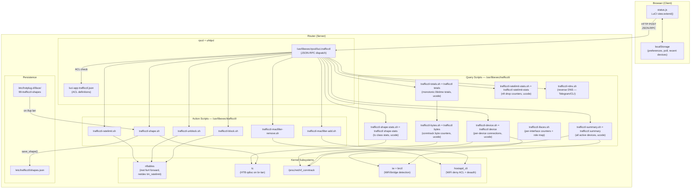
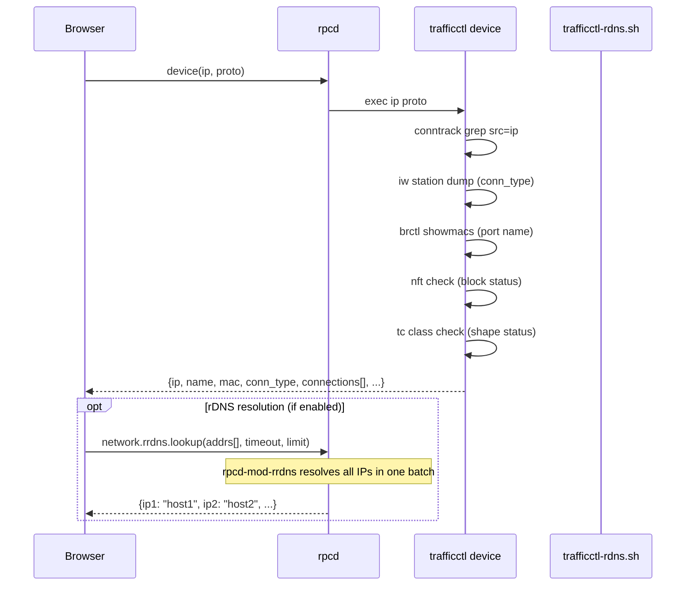
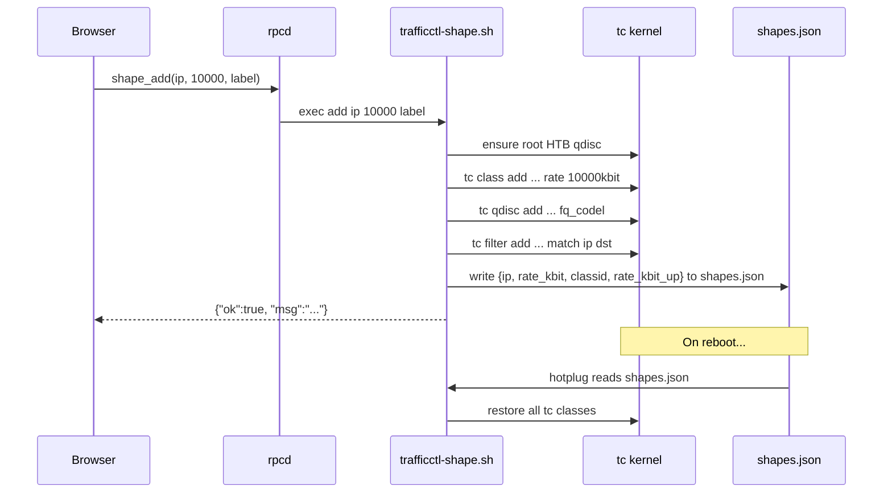
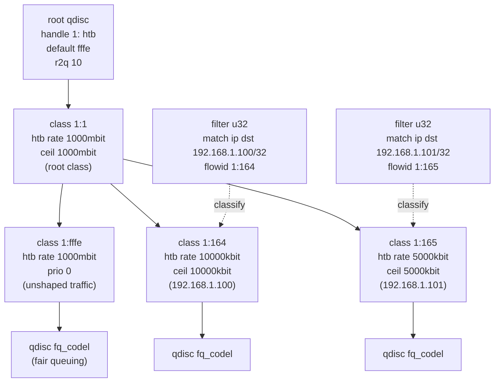
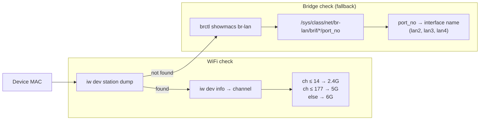

# Architecture

This document describes the internal architecture of luci-app-trafficctl.

---

## Design Principles

1. **No daemon** -- All operations are on-demand. No background process runs when the UI is closed.
2. **No compiled code** -- Pure shell scripts and JavaScript. Runs on any architecture without compilation.
3. **Minimal dependencies** -- Only requires `conntrack` and `luci-base`. Traffic shaping requires `tc-full` and `kmod-sched-htb` (optional).

---

## Component Diagram



---

## Data Flow

### Dashboard (All Devices View)

```mermaid
sequenceDiagram
    participant B as Browser
    participant R as rpcd
    participant S as trafficctl summary
    participant BY as trafficctl-totals.sh

    B->>R: summary()
    R->>S: exec
    S->>S: read /proc/net/nf_conntrack
    S->>S: iw station dump (WiFi MACs)
    S->>S: brctl showmacs (bridge ports)
    S->>S: check nft block status
    S->>S: check tc class (shape status)
    S-->>B: JSON array of devices

    loop Every N seconds (poll)
        B->>R: bytes()
        R->>BY: exec
        BY->>BY: trafficctl bytes (conntrack; degraded under uncountered offload)
        BY->>BY: accumulate positive deltas into /tmp/trafficctl_totals.state
        BY-->>B: [{ip, bytes_in, bytes_out, bytes_*_total, …}]
        B->>B: calculate speed = delta_bytes / delta_time
        B->>B: paint the cumulative Bytes/TCP/UDP cells
    end
```

### Per-Device View



### Action Flow (Example: Apply Shaper)



---

## Firewall Functions

The file `trafficctl-fw.sh` is sourced by all scripts and provides firewall functions:

```sh
. /usr/libexec/trafficctl/trafficctl-fw.sh

# TCTL_FW is the constant "nft"
```

### Key Functions

| Function | Implementation |
|----------|----------------|
| `tctl_ratelimit_add` | `netdev tm_ratelimit`: `ip daddr ... limit rate over ... drop` on every LAN device's egress chain `dl_<dev>` (WAN ingress chain `dl` on kernels without egress), `ip saddr ...` on every bridge port's ingress chain `ul_<port>`; in `each` mode one meter per chain (`tctl_rl_meter_name`). A device that refuses its rule is logged and reported (`partial`); the rules on the other devices stay |
| `tctl_ratelimit_remove` | `tctl_rl_delete_rules`: rules by exact comment and handle across all chains, then the meter sets those rules named (nftables 1.1 keeps them) |
| `tctl_block_add` | `nft add rule inet fw4 forward ip saddr ... drop` |
| `tctl_block_remove` | Delete rules by handle from `inet fw4 forward` |
| `tctl_is_blocked` | grep nft forward chain |
| `tctl_get_wan_device` | `uci get network.wan.device` (fallback to `.ifname`) |
| `tctl_get_lan_device` | `uci get network.lan.device` (fallback to `.ifname`) |
| `tctl_validate_ip` | regex + octet range check, no leading zeros |
| `tctl_get_wifi_interfaces` | `uci show wireless` parsing |

### Reading the rules back (ucode)

The writers above stay shell. Everything that reads their rules back for a
report (`trafficctl ratelimit-stats`, `shape-stats`, `rules`) is in
`trafficctl/files/usr/share/ucode/trafficctl/ctl.uc`:

- nft rules come from `nft -j list chain inet fw4 forward` and
  `nft -j list table netdev tm_ratelimit`. A rule is told by its comment
  (its handle is carried along for the caller), and an address is the whole
  `ip daddr`/`ip saddr` field; of the expressions only matches, limits,
  meters, counters and the verdict are read. A block is a drop rule whose
  comment starts with `tctl_block_` on its `ip saddr`, since blocks written
  before v1.13.2 carry the caller's label there, or whose comment is exactly
  `tctl_block_<slug>_mac` (the IPv6 half). Rates convert as
  the shell did: nft's unit steps of 1024, then SI kbit rounded to the
  nearest. A per-address meter is `meter` in nftables 1.0 and a dynamic set
  the rule adds to (`set` with a limit `stmt`) in 1.1; both read as `each`.
- There is no text fallback for nft. `nft -j` needs nftables built with JSON,
  and firewall4, which this package depends on, depends on `nftables-json`
  (checked in the 22.03.7 and 25.12.4 rootfs).
- tc stays text: iproute2 5.15 (22.03) prints `tc -j class` as text, and
  `tc -j qdisc` reports the fq_codel target in kernel microseconds (4999 for
  `5ms`), which would change the reported figure.

`tools/ci/live-readers.sh` (the `live-readers` job in `compat.yml`) builds real
blocks, limits and shapes with the shell writers in the 22.03.7 and 25.12.4
rootfs and compares the v1.30.0 readers with the CLI on that state. The
bridge has two dummy ports, so the upload rules land on more than one
`ul_<port>` chain. The container runs on the CI host's kernel, which has the
netdev egress hook, so the job never takes the WAN-ingress `dl` fallback that
22.03's 5.10 kernel needs. The second port is also where the each-mode
writer bug of 1.30.4 and earlier showed on 22.03: every `ul_<port>` chain got
the same meter name, nftables 1.0.2 refused the second one ("Resource busy")
and `ul_lan2` had no IPv4 upload rule. Since 1.30.5 every chain has its own
meter, and the job checks that `ul_lan2` holds the upload rule of each
each-mode target before it compares the readers.

---

## tc/HTB Hierarchy

Traffic shaping uses a single HTB qdisc on the LAN bridge egress (br-lan). This controls download speed to LAN devices.



### Class ID Allocation

A device's class ID is **allocated, not derived from its address**, and stored
in `shapes.json` next to the rate:

```json
{"ip":"192.168.1.100","rate_kbit":10000,"classid":"1:2","rate_kbit_up":2000}
```

- `alloc_classid` hands out the lowest free minor in `2..65533`, checking both
  `shapes.json` and the live `tc class show` on the LAN and IFB devices.
- `lookup_classid` reads the recorded minor, so a device keeps its class for as
  long as it is shaped, and `trafficctl shape-stats` maps class to IP from
  `shapes.json` alone.
- `1:1` (root) and `1:fffe` (default, unshaped) are reserved and never allocated.

The original derivation, `1:<hex(third_octet * 256 + fourth_octet)>`, put
`192.168.0.1` on the root class `1:1` (shaping it tore down every other
device's shape), put `x.x.255.254` on the default class, and collided across
subnets: `192.168.1.50` and `10.0.1.50` both mapped to `1:132`. It survives
only as `legacy_classid`, used to remove shapes persisted before the change.

### Filter Matching

A u32 filter routes packets to the correct class:

```
tc filter add dev br-lan parent 1:0 prio 10 protocol ip u32 \
    match ip dst <IP>/32 flowid 1:<hex_id>
```

---

## Interface Detection

The system detects how each device is connected (WiFi band or LAN port):



---

## Polling Architecture

The frontend uses independent polling loops:

| Poll | Interval | Script | Purpose |
|------|----------|--------|---------|
| Bytes | Configurable (default 2s, 1s–5s, or off) | `trafficctl-totals.sh` | Bandwidth speed = delta bytes / delta time, **and** the cumulative Bytes/TCP/UDP columns. This poll is also what advances the lifetime totals — with the page closed and no Prometheus scraper, they stand still |
| Interfaces | Same tick as Bytes, only while the Overview panel is open | `trafficctl-ifaces.sh` | Per-interface throughput for the global overview. Deliberately has no timer of its own, so it inherits the Poll interval |
| Drops | 5s | `trafficctl-ratelimit-stats.sh` | nft policer drop counters |
| Shape stats | 5s | `trafficctl-shape-stats.sh` | tc class stats (backlog, drops, overlimits) |
| Summary | On-demand / auto-refresh (5s–60s) | `trafficctl summary` | Full device list refresh. The reverse-DNS refresh and the DPI collection it starts run detached and never hold up the poll |

### Speed Calculation

Speed is calculated as `(bytes_now - bytes_prev) / dt` for both download and upload. A spike filter caps values at 1 Gbit/s (125 MB/s) to discard counter resets. The frontend maintains two histories per device:

- `_speedHistory` -- sliding window (trimmed to avgWindow/pollInterval samples) for sparkline and averaging.
- `_fullHistory` -- never trimmed, used by the popup graph to show the entire session.

### Graph Features

Two rendering contexts use the same `renderFullGraph()` function:

**Hover popup** (any sparkline): interactive SVG overlay.
**Inline device graph** (device detail view): static SVG rendered below the action buttons when a specific device is selected. Updates on every bytes poll.

Both share:
- Dual lines: download (solid blue) + upload (dashed green)
- Gradient area fill with linear gradient
- Min/max band (rolling window ±5 points)
- Rate limit line (from shapeMap or summary data)
- Nice Y-axis ticks (multiples of 100/500 Kbit/s, min 5 grid lines)
- 98th percentile scaling (outliers don't crush the graph)

The popup additionally has an interactive crosshair with precise DL/UL values.

Polling stops when:
- The browser tab is hidden (`document.hidden === true`).
- The user switches to per-device view (only device-specific polls run).
- The user sets poll to "Off".
- The user navigates away (timers cleared in `handleTeardown()`).

---

## WiFi MAC Filtering

WiFi MAC filtering does not hardcode interface names. It dynamically discovers all wifi-iface sections:

```sh
uci show wireless | grep '=wifi-iface' | cut -d= -f1
```

This returns paths like `wireless.default_radio0`, `wireless.default_radio1`, etc. The scripts then:
1. Set `macfilter=deny` on each interface (UCI).
2. Add/remove the target MAC from each interface's `maclist` (UCI).
3. `uci commit wireless` persists the change.
4. At runtime, use `hostapd_cli` to apply immediately without wifi reload:
   - **Block:** `hostapd_cli -i wlanX deny_acl ADD_MAC <mac>` + `hostapd_cli -i wlanX deauthenticate <mac>`
   - **Unblock:** `hostapd_cli -i wlanX deny_acl DEL_MAC <mac>`

This approach disconnects only the target client. All other WiFi clients remain connected.

`hostapd_cli` comes from `hostapd-utils`, which the `trafficctl` backend does not depend on (it can only be selected with a hostapd/wpad variant, so the dependency would block wired-only builds). Without it step 4 falls back to `ubus call hostapd.<iface> del_client` with a one-hour `ban_time`, reported as `"enforcement":"ban"`. With no wifi-iface at all the scripts answer `"no wifi interfaces found"` and touch nothing. `tctl_wifi_filter_support` reports `none` / `temporary` / `full` as `wifi_filter` in `trafficctl-device.sh`, and the view hides or annotates the Block WiFi button from it.

---

## Persistence

| Feature | Persisted | Storage | Rationale |
|---------|-----------|---------|-----------|
| Shaping (tc/HTB) | Always | `/etc/trafficctl/shapes.json` | Long-term bandwidth allocation |
| Rate limiting (nft policer) | Optional (`persist_rules`) | `/etc/trafficctl/rules.json` | Configurable -- may be temporary or permanent |
| Internet blocking | Optional (`persist_rules`) | `/etc/trafficctl/rules.json` | Configurable -- may be temporary or permanent |
| WiFi MAC filtering | Always | `uci commit wireless` | Committed to `/etc/config/wireless` |

The hotplug script triggers on `ACTION=ifup` and `INTERFACE=lan`, with a readiness loop (waits up to 10s for tc to be available on the bridge device). When `persist_rules` is enabled, blocks and ratelimits are saved/removed from `/etc/trafficctl/rules.json` alongside shape operations.

---

## Telegram Bot

Optional long-polling daemon (`trafficctl-telegram.sh`) running under procd.

```
Telegram API  ←──curl long poll──  trafficctl-telegram.sh (procd)
                                        │
                                        ├── trafficctl-summary.sh (device list)
                                        ├── trafficctl-block.sh / unblock.sh
                                        ├── trafficctl-macfilter-add/remove.sh
                                        ├── trafficctl-ratelimit.sh
                                        └── trafficctl-shape.sh
```

- **Polling:** `getUpdates?timeout=N` acts as both fetch and sleep — no separate timer needed.
- **Security:** Only responds to messages from the configured `chat_id`. Unauthorized messages are silently dropped.
- **Device cache:** Summary output is cached for 5 seconds in `/tmp/trafficctl_tg_devices.json`.
- **Notifications:** since 1.31 the bot only takes commands. New device and known device messages come from `trafficctl.notify` (`notify.uc`): its device scan runs as `/etc/init.d/trafficctl-notify` and keeps the bot's ledger, `/etc/trafficctl/telegram_known.json`; the Telegram sender (`notify_telegram`) uses the bot's token and chat unless it has its own. Every event also goes out on ubus (`trafficctl.notify`) and to `/etc/hotplug.d/trafficctl/`. See `docs/API.md`, "Notifications".
- **Configuration:** UCI section `trafficctl.telegram` with token, chat_id and button toggles. Token is masked (never returned to the frontend).
- **Init:** procd `respawn 3600 5 5` + `service_triggers` for auto-reload on UCI commit.

---

## Security Model

- All script execution is gated by rpcd ACLs (`luci-app-trafficctl.json`).
- Only authenticated LuCI admin users can invoke scripts.
- IP validation: regex + octet range (0–255) before any operation.
- Label/comment sanitization: `tr -cd 'a-zA-Z0-9_.-'` strips injection characters.
- Protocol parameter: `case` whitelist (`tcp|udp|all`), not interpolated.
- No user-supplied strings are passed to shell eval.
- File locking for concurrent `shapes.json` writes.
- Telegram bot token stored in UCI with file mode 0600; token is masked in rpcd responses (`***`).
